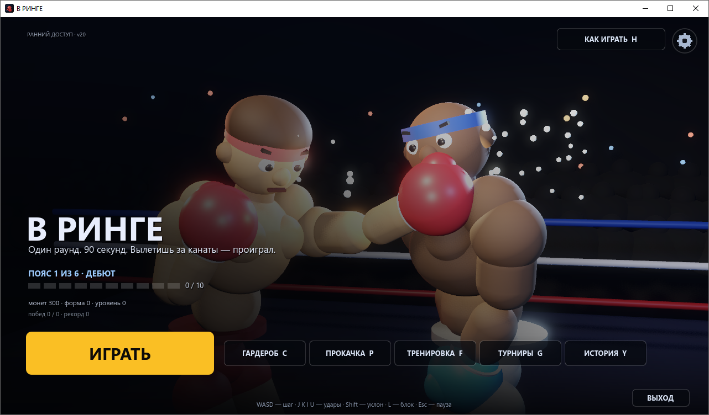
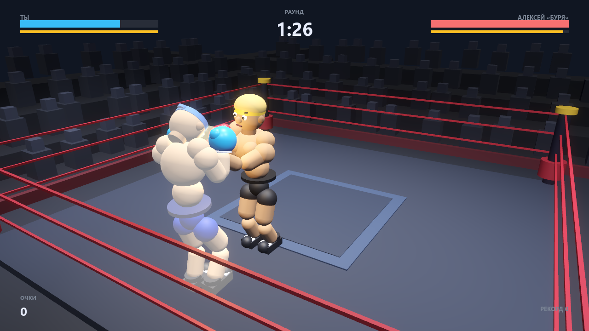
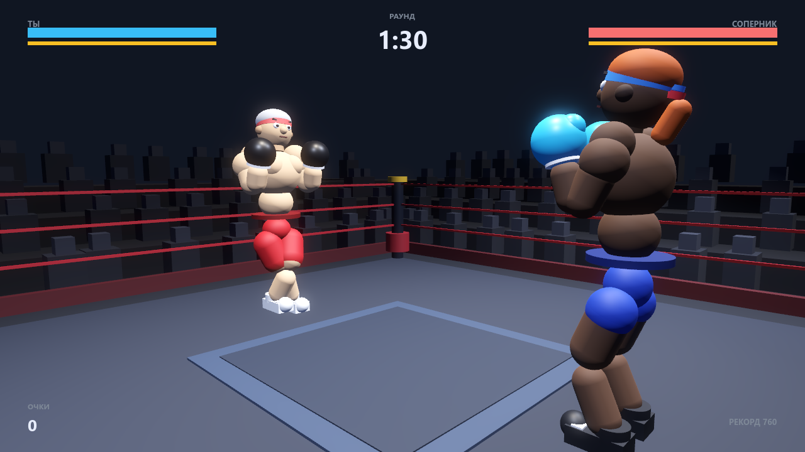
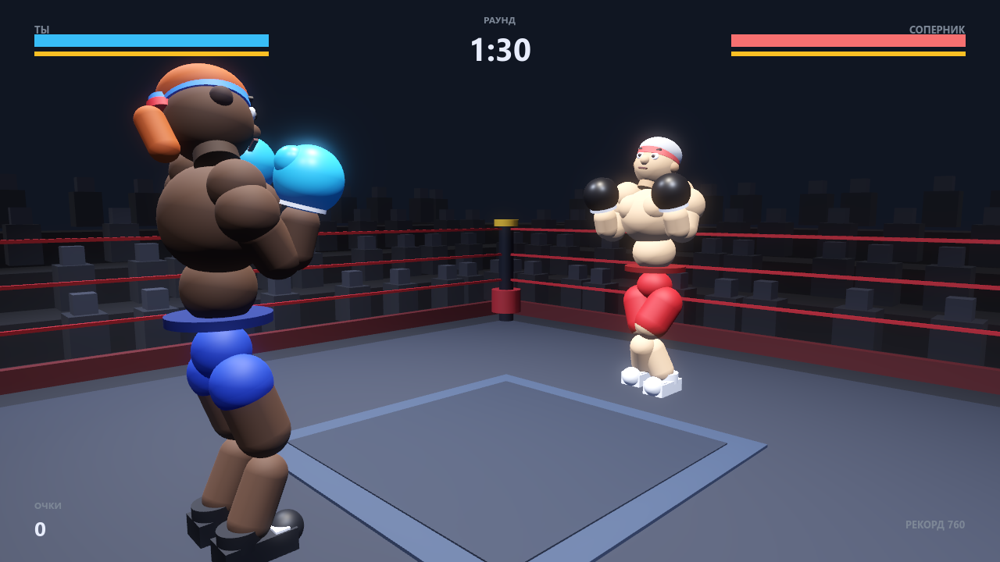
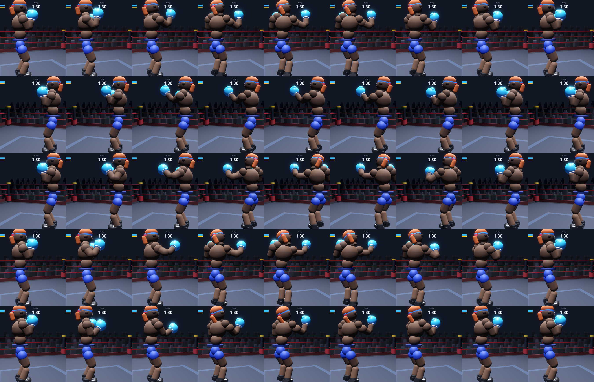
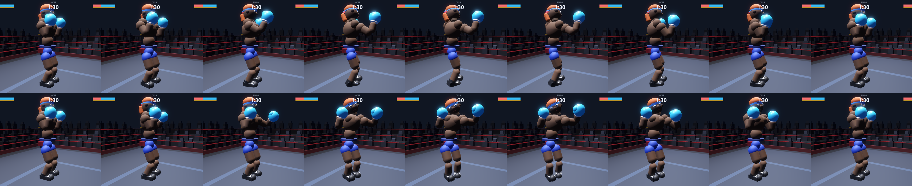
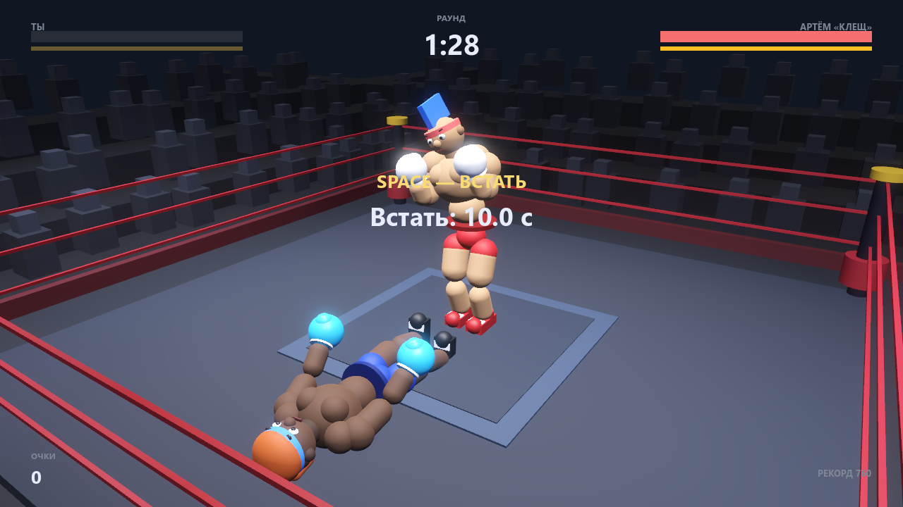
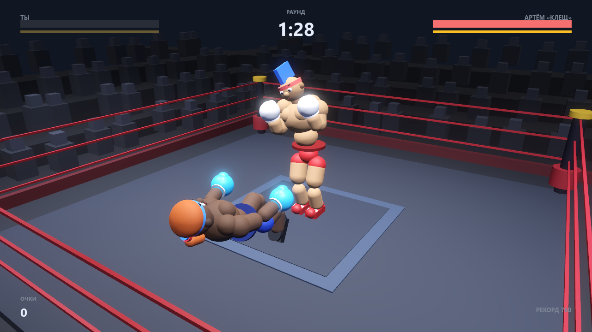
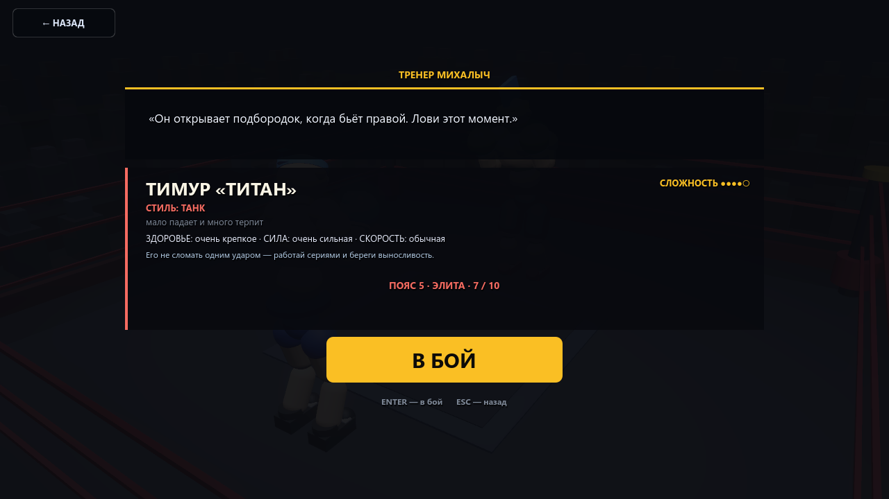

# В РИНГЕ — бокс на Godot 4.7 (ПК)

Аркадный бокс от третьего лица: один раунд, 90 секунд, вылет за канаты — поражение.
Бойцы — активные ragdoll-модели на пружинных мышцах: удары, уклоны, блок, нокдауны и
вылет за канаты выглядят как физика, а не как заранее записанная анимация.

Готовая сборка — в разделе **Releases** (`Ring3D.exe`, Windows x64, портативная).
Просто скачай и запусти: установка не нужна.



## Что внутри

- **Карьера:** 6 поясов по 10 соперников, сложность растёт **каждый бой** (60 уровней):
  здоровье 103→216, урон ×0.82→×2.30, скорость удара до −33 %.
- **Пять ударов:** джеб, кросс (`E`), два хука и апперкот. С `Ctrl` те же удары
  идут в корпус — в голову не считаются, зато снимают выносливость.
- **Живые траектории ударов:** у каждого удара своя дуга — крюк идёт сбоку с
  разворотом корпуса, апперкот снизу с проседанием коленей, прямые почти по нитке.
  Перчатка ведётся по кривой из замаха в точку попадания, а IK руки считается
  после доворота корпуса, поэтому не уезжает вместе с торсом.
- **Доворот тела в удар:** корпус, таз и стопы разворачиваются в сторону удара,
  как в настоящем боксе — кросс с пяткой задней ноги и доворотом на 22°, хук
  вокруг передней стопы, апперкот с просадкой и подъёмом пятки. Голова при этом
  держит соперника в поле зрения.
- **Буферизация ввода:** нажатие во время удара не теряется, а доигрывается
  после него (окно 0.16 с).
- **Нокдаун и подъём:** HP на нуле — не смерть, а падение. Лежишь, на экране
  подсказка `SPACE — ВСТАТЬ` и отсчёт 10 секунд; встал — вернулось 50 % HP,
  второй раз 35 %, третий 20 %. Не встал — поражение. Всего три нокдауна, после
  них — КО. Соперник падает по тем же правилам и встаёт сам.
- **Штраф за поражение:** проигранный бой списывает 40 монет (настраивается,
  не больше, чем есть; один раз за бой).
- **Восемь стилей соперников:** панчер, скоростник, защитник, агрессор, снайпер,
  контрбоксёр, танк, клинчер — у каждого своя манера боя, своё имя и своя внешность.
  Без прокачки высокие пояса не проходятся: в конце 6-го пояса нужно 27 чистых
  ударов против 6 у соперника, с максимальной прокачкой — 19 против 11.
- **Сюжетные турниры:** три кубка по три боя подряд, награды — монеты, «форма», вещи.
- **Тренер Михалыч:** совет перед каждым боем (15 фраз, не повторяются) и оценка
  боя после него.
- **История:** пролог и шесть глав, открываются по мере карьеры (`Y` или кнопка в меню).
- **Прокачка за «форму»:** сила, скорость, выносливость, защита, здоровье.
- **Гардероб:** причёски, перчатки, шорты, обувь, цвета — покупаются за монеты.
- **Тренировка:** бей по мешку, копи «форму».
- **Настройки:** клавиши, громкость музыки и звуков боя, язык RU/EN, полный экран,
  сброс прогресса.
- **Сохранение:** профиль пишется в `%APPDATA%\VRinge\` после боя, паузы, выхода
  в меню и закрытия окна.

















## Управление

| Действие | Клавиша |
|---|---|
| Шаг | `WASD` или стрелки |
| Уклон | `Shift` |
| Блок (держать) | `L` |
| Джеб | `J` |
| Кросс (прямой правой) | `E` |
| Корпусной удар | `Ctrl` + любая клавиша удара |
| Левый хук | `K` |
| Правый хук | `I` |
| Апперкот | `U` |
| Встать после нокдауна (10 секунд) | `Space` |
| Пауза / назад | `Esc` |

Меню: `Enter`/`Space` — бой, `C` — гардероб, `P` — прокачка, `F` — тренировка,
`G` — турниры, `Y` — история, `T`/`V` — настройки, `H`/`F1` — как играть,
`F11` — полный экран, `M` — в главное меню из паузы/итога.

## Как собрать

Нужен Godot 4.7.2 (шаблоны экспорта для Windows).

```bash
godot --headless --path . --export-release "Windows Desktop" build/Ring3D.exe
```

Иконка рисуется скриптом `tools/make_icon.ps1` (PNG + ICO).

## Технически

- GDScript, один проект без внешних ассетов: вся геометрия строится кодом.
- Активный ragdoll: точки массы, пружинные мышцы, IK на две кости, постановка стоп.
- Звук синтезируется на лету, шины `Music`/`SFX` регулируются отдельно.
- HUD и все экраны — процедурные `Control`-узлы, локализация в `scripts/lang.gd`.

## Мобильная версия

Отдельный репозиторий: [v-ringe-mobile](https://github.com/Kirtus228/v-ringe-mobile) —
APK для Android и веб-сборка с сенсорным управлением (удары — слева внизу, стик — справа).
